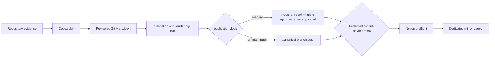

# Notion Project Docs

A skills-only Codex plugin that turns repository evidence into reviewable
project documentation and mirrors approved Git Markdown to dedicated Notion
pages.

> Release status: v0.2.0 is published in this public GitHub repository. It is
> not submitted to the universal Plugins Directory.

[한국어 안내](./README.ko.md)

## Start here

If you are new to Codex, Notion integrations, or GitHub Actions, follow the
[beginner installation and usage guide (Korean)](./docs/BEGINNER_GUIDE.ko.md)
before installing or configuring this plugin. It covers installation, Notion
and GitHub connection, safe first publication, everyday prompts, and common
problems.

## Why this exists

Project documentation often fails in one of two ways: it becomes a polished
claim with weak evidence, or it stays accurate but never becomes useful to
external readers. This plugin keeps Git Markdown as the source of truth,
requires explicit evidence boundaries, and makes Notion a controlled
presentation layer.

It is designed for:

- portfolio overviews and technical case studies;
- repository documentation audits and refreshes;
- multilingual document structures through configuration;
- deterministic Markdown validation;
- manual approval by default, with opt-in canonical-branch auto-publication.

## Safety model



No Notion write occurs on pull requests, non-canonical pushes, local dry runs,
or ordinary skill use. The one explicit exception is the setup wizard's
checked one-time initial publication, which requires a clean, tracked,
validated canonical-branch source and full Notion preflight. After connection,
the default `manual` mode requires workflow dispatch, the exact `PUBLISH`
confirmation and the configured canonical branch. It also uses
protected-environment approval when the repository and GitHub plan support
required reviewers. Repositories may explicitly choose `on-main-push` to
publish matching canonical-branch merges automatically.

## What is included

- `$maintain-project-docs`, a focused evidence-based documentation workflow;
- English and Korean portfolio templates;
- a versioned JSON configuration contract for one to twenty documents;
- a non-overwriting repository installer with a dry-run default;
- a local, one-time setup wizard that creates dedicated Notion mirror pages
  and configures protected GitHub environment secrets without persisting
  credentials, with an explicit initial-content publication option;
- a dependency-free validator for structure, placeholders, links, local paths,
  and common credential formats;
- a deterministic Notion Markdown publisher with full-page preflight,
  idempotency, link rewriting, source fingerprints, retry handling, and
  partial-failure reporting;
- a guarded GitHub Actions workflow;
- unit and integration tests that use stubbed Notion responses.

## Install the plugin

This public repository can be used as a skill source. Ask Codex to install
`skills/maintain-project-docs` from `Yeon-sik/notion-project-docs`, then start
a new task and invoke `$maintain-project-docs`. The
[beginner guide](./docs/BEGINNER_GUIDE.ko.md) gives the exact beginner flow.

## Set up a target repository

The installer previews all target paths and does not write by default:

```bash
node skills/maintain-project-docs/scripts/install-project-docs.mjs \
  --target /path/to/repository \
  --locale en \
  --canonical-branch main \
  --publication-mode manual \
  --environment notion-production
```

After reviewing the plan, add `--apply`. Differing existing files stop the
installation before any new file is written.

Use `$maintain-project-docs` to create and validate the configured Markdown
files, then review and commit the documents, configuration, runtime, templates,
and workflow to the configured canonical branch. Create one Notion parent
page, connect the internal Notion integration to that page, and run the local
setup wizard:

```bash
cd /path/to/repository
node /path/to/maintain-project-docs/scripts/setup-project-docs.mjs
```

The wizard opens a loopback-only browser page. Paste the integration token and
the connected parent page URL. It creates or safely reuses one dedicated child
page per configured document, restricts the protected environment to the
canonical branch, configures the current GitHub user as reviewer in `manual`
mode when the repository plan supports required reviewers, and stores
`NOTION_TOKEN` plus `NOTION_PAGE_IDS_JSON` through GitHub CLI stdin. Its checked
initial-publication option immediately fills the pages only when the source is
clean, tracked, validated, checked out on the canonical branch, and equal to
the current GitHub branch tip. Clear the option for connection-only setup. When GitHub rejects required reviewers with
its plan-specific HTTP 422 response, the wizard retries with only the
canonical-branch policy, omitting all unsupported protection-rule fields, and
shows a reduced-protection warning. If GitHub CLI authentication has expired,
**GitHub login/refresh** starts the browser device flow, copies the one-time
code to the clipboard, and times out after five minutes instead of waiting
indefinitely. No token or page map is written to the repository or browser
storage.

After setup:

1. Verify the initial Notion pages, source revision links, and fingerprints.
2. For later `manual` updates, run `operation: validate`, then publish with
   `operation: publish` and confirmation `PUBLISH`. Approve the environment
   when required reviewers are supported and configured.
3. For later `on-main-push` updates, merge a reviewed document change to the
   canonical branch; the workflow publishes automatically.

Manual GitHub and Notion configuration remains documented in the operations
runbook for environments where GitHub CLI or browser launch is unavailable.

See [the configuration reference](./skills/maintain-project-docs/references/CONFIGURATION.md)
and [operations runbook](./skills/maintain-project-docs/references/OPERATIONS.md).

## Configuration

```json
{
  "$schema": "./.github/project-docs/project-docs.config.schema.json",
  "version": 1,
  "canonicalBranch": "main",
  "publicationMode": "manual",
  "documents": [
    {
      "key": "overview",
      "label": "Project Overview",
      "path": "docs/Project_Overview.md",
      "requiredSections": ["Executive summary", "Verification"]
    }
  ]
}
```

Notion page IDs are deliberately absent from this file. They belong in the
protected `NOTION_PAGE_IDS_JSON` environment secret.

## Development

Requires Node.js 22.18 or newer and no third-party runtime dependencies.

```bash
npm run check
```

Before a release, also validate the plugin and skill with the current official
Codex validators:

```text
validate_plugin.py <plugin-root>
quick_validate.py <plugin-root>/skills/maintain-project-docs
```

See [architecture](./docs/ARCHITECTURE.md) and the
[release checklist](./docs/RELEASE_CHECKLIST.md).

## License

[MIT](./LICENSE)
