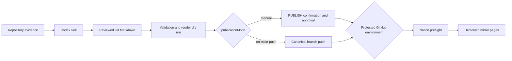

# Notion Project Docs

A skills-only Codex plugin that turns repository evidence into reviewable
project documentation and mirrors approved Git Markdown to dedicated Notion
pages.

> Release status: source-complete release candidate. It has not been pushed to
> a standalone GitHub repository or submitted to the universal Plugins
> Directory.

[한국어 안내](./README.ko.md)

## Why this exists

Project documentation often fails in one of two ways: it becomes a polished
claim with weak evidence, or it stays accurate but never becomes useful to
external readers. This plugin keeps Git Markdown as the source of truth,
requires explicit evidence boundaries, and makes Notion a controlled
presentation layer.

It is designed for:

- portfolio overviews and technical case studies;
- repository documentation audits and refreshes;
- multilingual document structures through configuration;
- deterministic Markdown validation;
- manual approval by default, with opt-in canonical-branch auto-publication.

## Safety model



No Notion write occurs on pull requests, non-canonical pushes, local dry runs,
or ordinary skill use. The default `manual` mode requires workflow dispatch,
the exact `PUBLISH` confirmation, the configured canonical branch, and
protected-environment approval. Repositories may explicitly choose
`on-main-push` to publish matching canonical-branch merges automatically.

## What is included

- `$maintain-project-docs`, a focused evidence-based documentation workflow;
- English and Korean portfolio templates;
- a versioned JSON configuration contract for one to twenty documents;
- a non-overwriting repository installer with a dry-run default;
- a dependency-free validator for structure, placeholders, links, local paths,
  and common credential formats;
- a deterministic Notion Markdown publisher with full-page preflight,
  idempotency, link rewriting, source fingerprints, retry handling, and
  partial-failure reporting;
- a guarded GitHub Actions workflow;
- unit and integration tests that use stubbed Notion responses.

## Install the plugin

After public release, install `Notion Project Docs` from the universal Plugins
Directory.

For source testing before release:

1. Clone this repository.
2. Add the plugin root to a local marketplace using `$plugin-creator`.
3. Install it from the local Plugins Directory.
4. Start a new task and invoke `$maintain-project-docs`.

Users who only need the skill can install
`skills/maintain-project-docs` from the GitHub repository with
`$skill-installer`.

## Set up a target repository

The installer previews all target paths and does not write by default:

```bash
node skills/maintain-project-docs/scripts/install-project-docs.mjs \
  --target /path/to/repository \
  --locale en \
  --canonical-branch main \
  --publication-mode manual \
  --environment notion-production
```

After reviewing the plan, add `--apply`. Differing existing files stop the
installation before any new file is written.

Then:

1. Use `$maintain-project-docs` to create the configured Markdown files.
2. Review and commit the documents, configuration, runtime, templates, and
   workflow together.
3. Create the protected GitHub environment named during installation and
   restrict it to the canonical branch.
4. Add `NOTION_TOKEN`.
5. Add `NOTION_PAGE_IDS_JSON`, mapping each configured document key to one
   dedicated Notion page ID.
6. Grant the Notion integration read-content and update-content access to every
   mirror page.
7. For `manual`, add a required reviewer, run `operation: validate`, then
   publish with `operation: publish` and confirmation `PUBLISH`.
8. For `on-main-push`, omit required reviewers and merge a reviewed document
   change to the canonical branch; the workflow publishes automatically.

See [the configuration reference](./skills/maintain-project-docs/references/CONFIGURATION.md)
and [operations runbook](./skills/maintain-project-docs/references/OPERATIONS.md).

## Configuration

```json
{
  "$schema": "./.github/project-docs/project-docs.config.schema.json",
  "version": 1,
  "canonicalBranch": "main",
  "publicationMode": "manual",
  "documents": [
    {
      "key": "overview",
      "label": "Project Overview",
      "path": "docs/Project_Overview.md",
      "requiredSections": ["Executive summary", "Verification"]
    }
  ]
}
```

Notion page IDs are deliberately absent from this file. They belong in the
protected `NOTION_PAGE_IDS_JSON` environment secret.

## Development

Requires Node.js 22.18 or newer and no third-party runtime dependencies.

```bash
npm run check
```

Before a release, also validate the plugin and skill with the current official
Codex validators:

```text
validate_plugin.py <plugin-root>
quick_validate.py <plugin-root>/skills/maintain-project-docs
```

See [architecture](./docs/ARCHITECTURE.md) and the
[release checklist](./docs/RELEASE_CHECKLIST.md).

## License

[MIT](./LICENSE)
